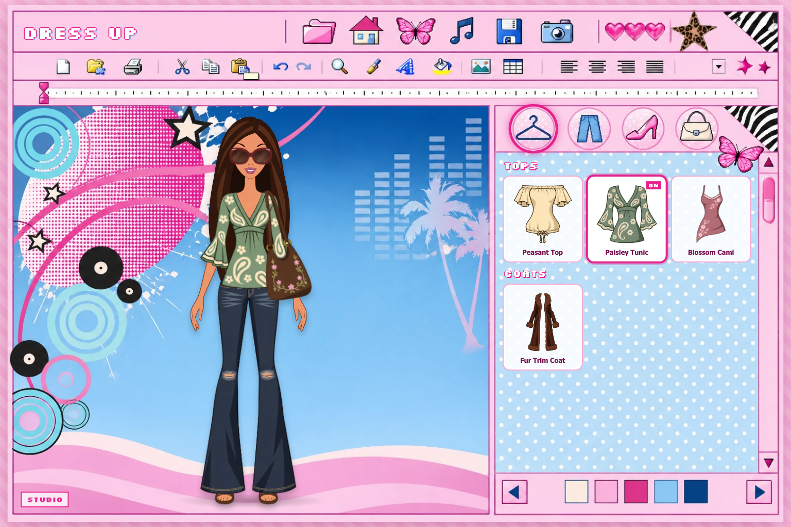
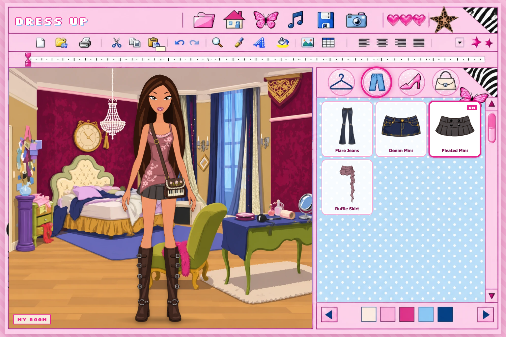
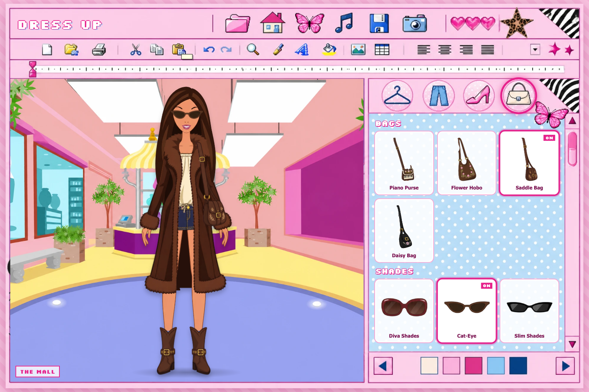

# Y2K Dress Up Game

A 2000s Flash-style fashion dress-up game that runs in the browser.

**Play it here: https://neelabk.github.io/y2k-dress-up-game/**



| My Room | The Mall |
| --- | --- |
|  |  |

## How to play

- Press PLAY, then pick a closet with the four round buttons: tops and coats, bottoms, shoes, bags and shades
- Click an item to put it on, click it again to take it off
- The arrows under the closet (or the house button) change the place: Studio, My Room, The Mall
- The butterfly picks a random outfit, the hearts rate the look, the camera saves a picture, and the music note turns the song on and off

## Run it on your own computer

The game needs to be opened from a web address (not by double-clicking the file) so the music and the camera button work. From this folder run:

```bash
python3 -m http.server 8765
```

then open http://localhost:8765 in a browser and press PLAY.

## What's here

- `index.html` – the whole game (layout, closet, music, save/photo)
- `assets/` – the doll, clothes, backgrounds and the frame picture
- `assets/thumbs/` – clean item pictures used in the closet

## Adding an item

Draw it in place on the 971x1620 doll canvas, save it as a transparent PNG in `assets/`, and add one line to the `ITEMS` list near the top of the script in `index.html`.
